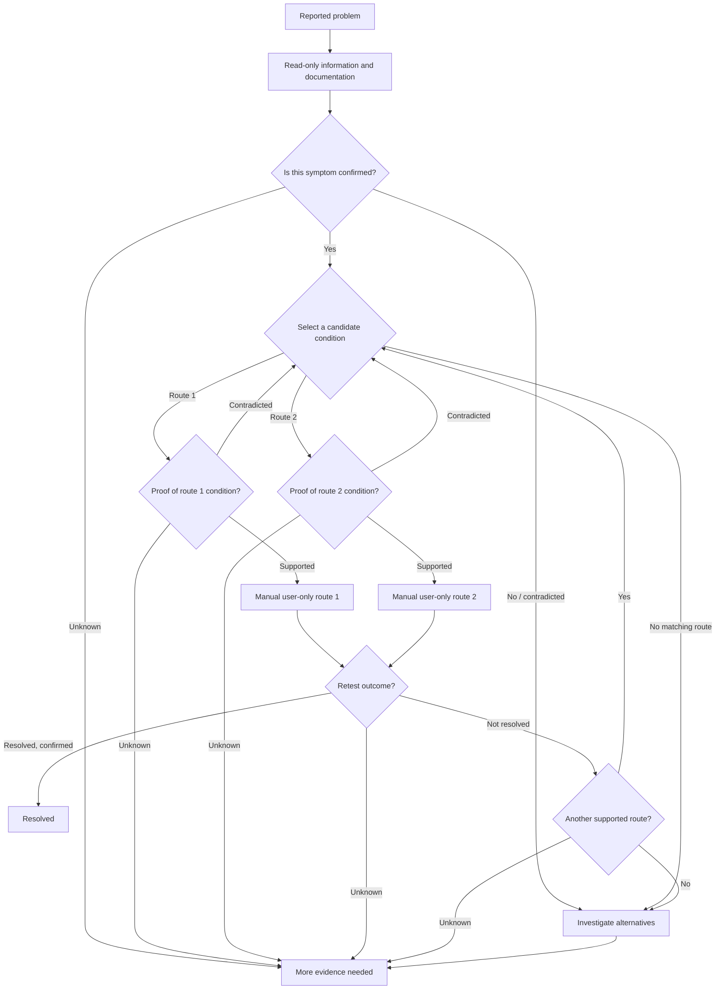

# Unified Hardware / Software diagnosis trees — evidence-gated revision 36

**Single machine-readable source:** [`../knowledge_sources/diagnosis_trees.json`](../knowledge_sources/diagnosis_trees.json)

The catalog contains **250 cases (103 hardware, 147 software)**, **500 manual solution routes**, **22 distinct curated cross-domain relationships (44 directions)** and **3,500 tree nodes**. The JSON has **schema version 2**: every one of the 500 route conditions now has its own three-way evidence gate. This is still a documentation/traversal catalog, **not** an automated diagnostic interpreter or AI training corpus.

## Why the evidence structure changed

In the original schema, evidence for one suspected cause was required *before* any of the alternative solution routes could be selected. For example, a correctly synchronized computer with an expired TLS certificate could not reach the route intended for invalid server certificates, because the first question demanded an incorrect system clock.

The new model separates **three distinct facts**:

1. **Reported symptom:** Does this case describe a problem that is actually observed? This does *not* establish root cause.
2. **Route-specific condition:** Does the available evidence support the exact condition for this particular documented route? This requires a separate confirmation for each route; choosing a route name is insufficient.
3. **Outcome after an appropriate retest:** The user confirms whether the original symptom has really stopped. A missing retest is *unknown*, never automatically resolved.



An **initial symptom confirmation is not permission** to apply route 1 or route 2. Missing log data is not negative evidence; correlated app crashes and GPU resets do not by themselves establish causality. Cross-domain transitions require a curated existing link and explicit user confirmation.

## Rebuilding and editorial provenance

The catalog is deterministically generated from the six historical source datasets **plus** [`../knowledge_sources/DIAGNOSIS_EDITORIAL_REVIEW_36.json`](../knowledge_sources/DIAGNOSIS_EDITORIAL_REVIEW_36.json). The latter holds 17 reviewed wording changes to avoid scope/route contradictions. Both hardware and software documentation builders apply these changes when reconstructing their reference handbooks; regeneration must not silently discard them.

```bash
python scripts/build_hardware_documentation34.py
python scripts/build_software_documentation35.py
python scripts/build_diagnosis_trees.py
python scripts/sync_docs.py
python -m pytest -q
```

The catalog is read-only. Its 57 original check-ID-bearing cases continue to reference *existing* allowlisted checks; 193 newer documentation-only cases still **have no runtime check IDs**. The generator does not authorize executing displayed shell text, network probes, repairs, changes to the OS, AI training or model inference.

## Example: route-specific gate

```python
from universal_linux_troubleshooter.knowledge.diagnosis_trees import load_trees, advance

t = load_trees()
cid = 'software35.network.time-tls'
assert advance(t, cid, 'start').node['id'] == 'collect'
assert advance(t, cid, 'collect').node['id'] == 'evidence'

# Human confirms there is an actual HTTPS certificate problem, not its cause.
assert advance(t, cid, 'evidence', choice='supported',
               confirmed_by_user=True).node['id'] == 'select_route'

# Route 2 is only a candidate until its own condition is assessed.
assert advance(t, cid, 'select_route', choice='route_2',
               confirmed_by_user=True).node['id'] == 'assess_route_2'

# Unknown information stops at more_evidence; it does not authorize a repair.
assert advance(t, cid, 'assess_route_2', choice='unknown',
               confirmed_by_user=True).node['id'] == 'more_evidence'
```

The `advance` function is a **stateless graph cursor**. It accepts explicitly supplied human verdicts and is *not* an evidence assessor; callers must preserve the traversal flow. Directly requesting a node does not grant command-execution privileges. Future GUI and AI integrations will require a separate, reviewed evidence interpreter and session state.

## Content-test limits

Automated tests cover all 250 symptom gates, all 500 individual route-assessment and verification paths, all 44 directional cross-domain transitions, deliberate malformed-graph attacks and 47 additional *synthetic* scenarios (including the six earlier conflicts). **A passing scenario does not prove real diagnostic accuracy.** Human examination of logs, hardware-specific checks, distribution variations, the suitability of route content and outcome confirmation are separate next-phase quality gates. No automatic repairs are introduced, and no Qwen training has been performed.

## Ontwikkelupdate v37 — eerste autonome bewijslaag

De centrale JSON is **ongewijzigd**. Zie [Autonome diagnosecontrole v37](validation/autonomous-v37.md) voor de beperkte integratie van zes gecontroleerde cases, de tien simulaties en de expliciete resterende dekking. Gevalideerde resultaten zijn zelf uitgevoerd; onbekende gegevens leiden nooit tot een verzonnen oplossing. Andere bomen blijven documentatie tot hun bewijsdefinities onafhankelijk zijn gecontroleerd. Geen Qwen-training of Flatpak-release.
